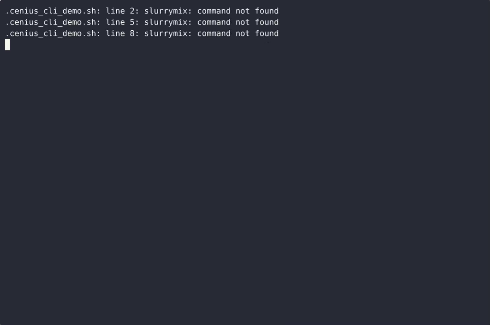
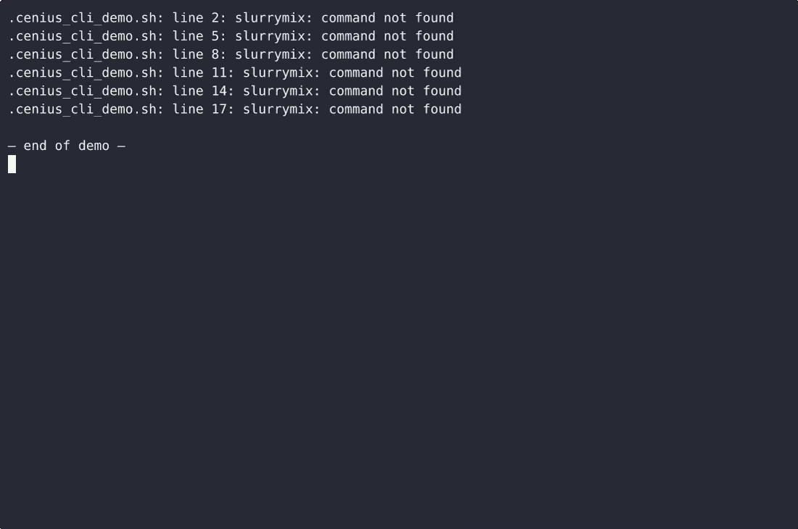

# Slurrymix — complete Full-stack app command-line tool example app

A Full-stack app command-line tool, open-source and ready to self-host: that's **Slurrymix**. Slurrymix is a single-file, standard-library-only Python command-line tool for a single farm operator that (1) calculates how much manure slurry to spread to hit a nitrogen target, (2) plans and tracks a season's fiel…. Slurrymix ships complete — source, design assets, seed data — under the Apache-2.0 license; no cloud account needed. [Remix Slurrymix on cenius.ai](https://cenius.ai/marketplace/p/slurrymix?ref=gh&utm_campaign=slurrymix-webapp) for a custom build.


[](LICENSE)  [](https://cenius.ai)

[](https://cenius.ai/marketplace/p/slurrymix?ref=gh&utm_campaign=slurrymix-webapp)

> **▶ [Open & edit in cenius.ai](https://cenius.ai/marketplace/p/slurrymix?ref=gh&utm_campaign=slurrymix-webapp)** — one click to an editable workspace: describe changes in plain English, get an instant preview, one-click deploy and host. Modifications made on the platform come with full rebrand & relicense rights.

_Local clone? See [Quick start](#quick-start) below. cenius.ai is the zero-setup path._

## Demo


📽 **[Watch the walkthrough](https://cenius.ai/marketplace/p/slurrymix?ref=gh&utm_campaign=slurrymix-webapp)** — plays on cenius.ai · [MP4 file](.github/media/demo.mp4)

## Screenshots

 

## Usage guide

Every command below is real output from the shipped tool. Run them from the
directory that holds your `slurrymix.json` (or add `--state PATH` to any of them).
Throughout, `slurrymix` means `python3 slurrymix.py` (or the console command after
`install.sh`).

### 1. Register the field

```bash
slurrymix field add --name "North 12" --area 4.5 --crop wheat --target-n 170
```

```
added field North 12 (#1): 4.5 ha of wheat, target 170 kg N/ha (765 kg N this season)
```

`--target-n` is the nitrogen the crop is allowed over the whole season; Slurrymix
multiplies it by the area to get the field's season budget (765 kg N here).

```bash
slurrymix field list
```

```
Fields (1)
ID  NAME      AREA (ha)  CROP   TARGET (kg N/ha)
──  ────────  ─────────  ─────  ────────────────
 1  North 12        4.5  wheat               170
```

With nothing stored yet, the command invites the exact next step:

```
$ slurrymix field list
no fields yet - register one with:
  slurrymix field add --name "North 12" --area 4.5 --crop wheat --target-n 170
```

### 2. Record what your slurry is worth

```bash
slurrymix batch add --label "Pit A March" --source cattle --n 4.2 --dm 8.5 --sampled 2026-03-02
slurrymix batch list
```

```
added batch Pit A March (#1): cattle slurry, 4.2 kg N/m3, 8.5% dry matter

Slurry batches (1)
ID  LABEL        SOURCE  N (kg N/m3)  DRY MATTER (%)  SAMPLED
──  ───────────  ──────  ───────────  ──────────────  ──────────
 1  Pit A March  cattle          4.2             8.5  2026-03-02
```

_Full guide: [`USAGE.md`](USAGE.md)_

## Features

- Slurry mix ratio calculator (target nitrogen)
- Spread field rotation planner
- Storage capacity tracker
- Local JSON persistence
- Metric input validation and output discipline
- Guided interactive wizard
- CSV export of plan and storage

## Quick start

```bash
./install.sh   # installs dependencies + seeds demo data
```

See [`INSTALL.md`](INSTALL.md) for full setup and usage instructions.

## Architecture

Everything runs out of the box: a Full-stack app codebase (23 files). `install.sh` takes care of packages and initial data in a single pass; nothing else is required before launching. See [`INSTALL.md`](INSTALL.md) for complete setup instructions.

## FAQ

### How do I self-host Slurrymix?

Clone this repository and run `./install.sh`, then start the app as described in [`INSTALL.md`](INSTALL.md). Slurrymix is fully self-hostable — no external services are required to try it.

### Is there a no-code way to modify Slurrymix?

Describe what you want changed on [cenius.ai](https://cenius.ai/marketplace/p/slurrymix?ref=gh&utm_campaign=slurrymix-webapp) — no code editing needed; the platform produces a fresh build you can download and deploy.

### Which technology stack does Slurrymix use?

The app is built with Full-stack app. What you see in this repo is the full production source, demo data included. Highlights include guided interactive wizard.

### Does the Slurrymix license allow commercial use?

Yes. The code is Apache-2.0-licensed — use it, modify it, and ship it commercially. See [LICENSE](LICENSE).

### Is it possible to white-label Slurrymix for a client?

Yes — and the easiest way is [remixing it on cenius.ai](https://cenius.ai/marketplace/p/slurrymix?ref=gh&utm_campaign=slurrymix-webapp): modifications made on the platform come with full rebrand and relicense rights over your derivative.

## License & rebranding

Released under the [Apache License 2.0](LICENSE) (© 2026 Cenius AI) — free for personal and commercial use. The Cenius name/logo are trademarks (see NOTICE).

**Need a customized version?** [Remix this app on cenius.ai](https://cenius.ai/marketplace/p/slurrymix?ref=gh&utm_campaign=slurrymix-webapp) — modifications made on the platform come with **full rebrand & relicense rights** over your derivative.

## Built with cenius.ai

This entire application — code, design, seeded demo data — was generated on **[cenius.ai](https://cenius.ai)** from a plain-English description.

- 🚀 [Build your own app on cenius.ai](https://cenius.ai)
- 🎛️ [Remix Slurrymix on the marketplace](https://cenius.ai/marketplace/p/slurrymix?ref=gh&utm_campaign=slurrymix-webapp) — open it in a workspace, prompt for changes, and ship your own version.

More open-source apps: [the Cenius-ai catalog](https://github.com/Cenius-ai) · [showcase index](https://github.com/Cenius-ai/showcase)
